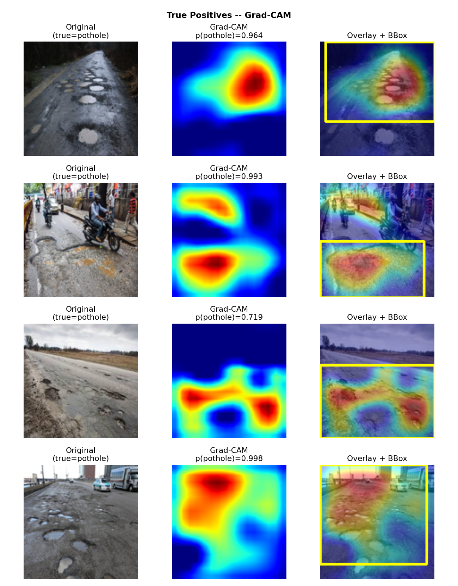
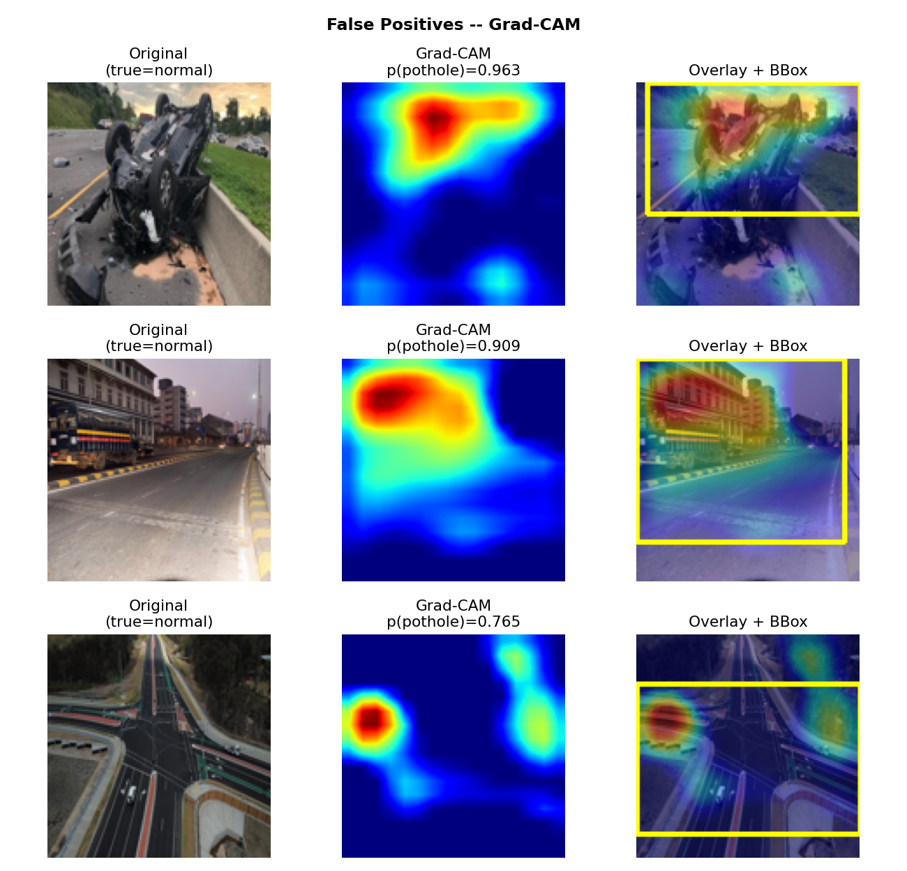
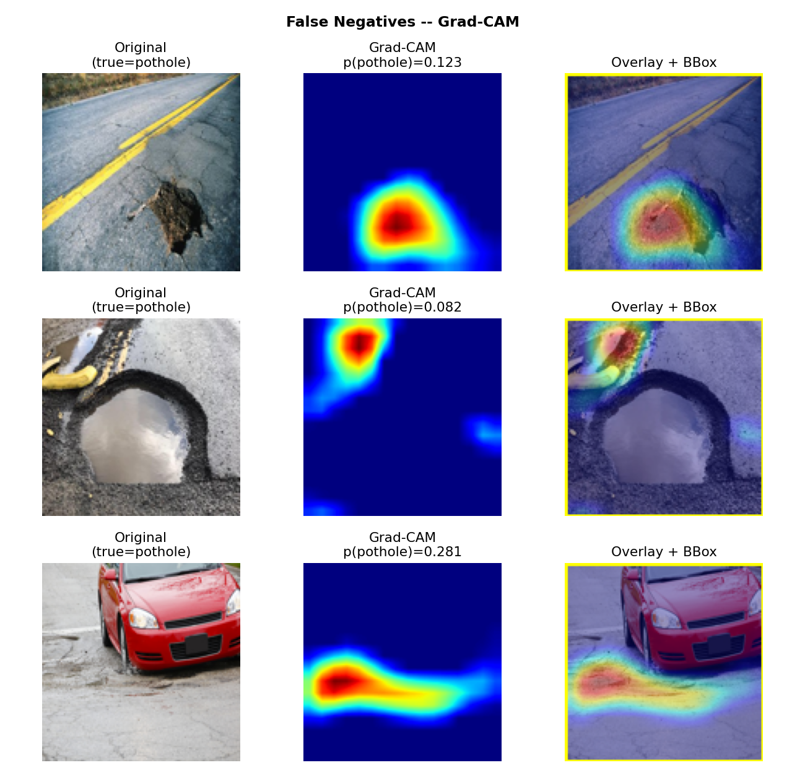
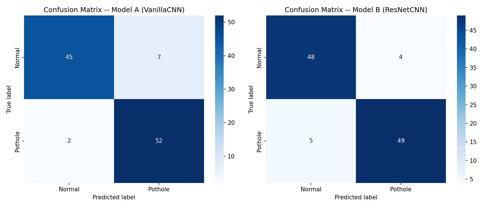
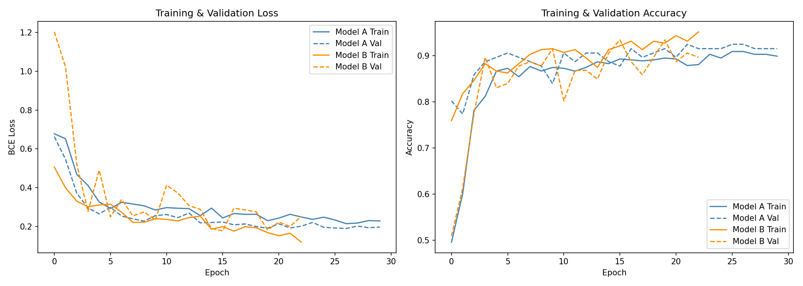
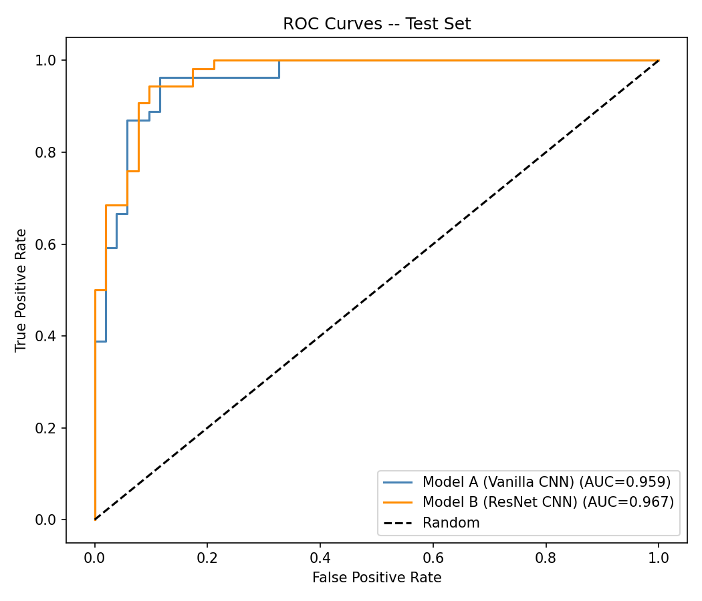
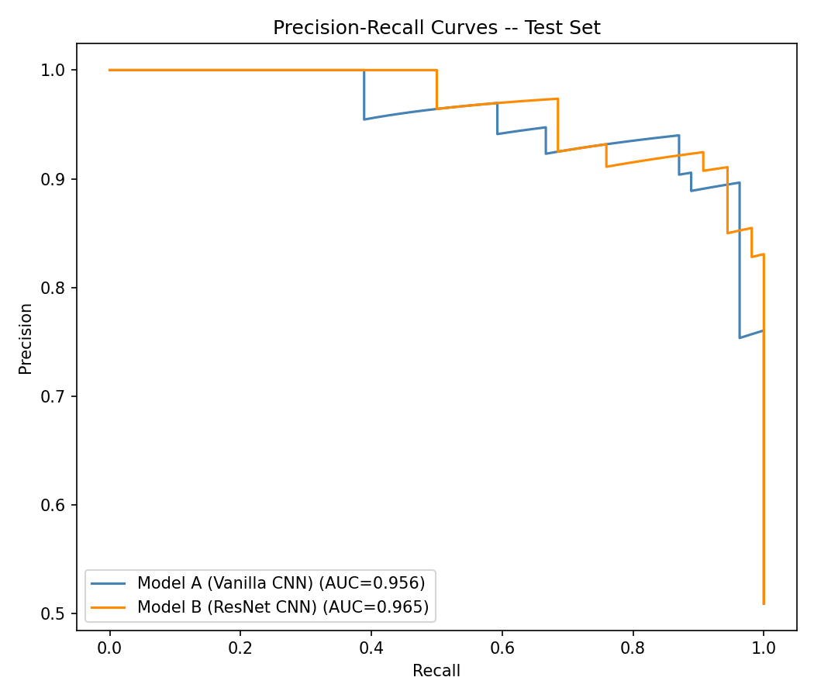

# 🛣️ Pothole Detection System

> **End-Term Practical Project** — *Introduction to Deep Learning (B.Tech Sem V)*  
> **Framework:** PyTorch (Trained from Scratch — Zero Transfer Learning)  
> **Core Concepts:** Vanilla CNN vs. Residual CNN with BatchNorm, Grad-CAM Explainable AI, 1-D Kalman Filter Temporal Smoothing.

---

## 📌 Project Overview

This project implements an end-to-end Pothole Detection and Weakly-Supervised Localization system trained entirely from scratch on a Kaggle road dataset. The workflow is strictly aligned with the B.Tech Deep Learning syllabus:
- **ML Workflow & Data Audit**: Byte-level MD5 deduplication, stratified 70/15/15 train/val/test splits, balanced class weighting.
- **Architectural Exploration**:
  - **Model A (Vanilla CNN)**: Sequential conv-pool architecture (~126K parameters).
  - **Model B (ResNet CNN with BatchNorm)**: Deep residual blocks with skip connections and batch normalization (~716K parameters).
- **Explainable AI (XAI)**: Native implementation of **Grad-CAM** registered on `last_conv` to extract activation heatmaps and derive bounding boxes without bounding-box annotations.
- **Temporal Video Smoothing**: **1-D Kalman Filter** ($Q=0.01, R=0.10$) to stabilize per-frame probabilities across road video sequences.

---

## 📊 Empirical Results (Unseen Test Set, $N = 106$)

The decision threshold was strictly selected on the validation set by maximizing $F_1$ ($\tau = 0.31$, Val $F_1 = 93.69\%$).

| Model | Parameters | Accuracy | Precision | Recall | $F_1$ Score | ROC-AUC | $F_1$ 95% Bootstrap CI |
| :--- | :---: | :---: | :---: | :---: | :---: | :---: | :---: |
| **Majority Baseline** | — | 50.94% | — | 100.0% | 0.6750 | 0.5000 | — |
| **Model A (Vanilla CNN)** | 126,529 | **91.51%** | 88.14% | **96.30%** | **0.9204** | 0.9590 | **[0.8571, 0.9655]** |
| **Model B (ResNet CNN)** | 716,865 | **91.51%** | **92.45%** | 90.74% | **0.9159** | **0.9669** | **[0.8496, 0.9663]** |

### Confusion Matrix Breakdown (Test Set)
- **Model B (ResNet CNN)**: TN = 48, FP = 4, FN = 5, TP = 49 (Higher precision, lower false alarm rate).
- **Model A (Vanilla CNN)**: TN = 45, FP = 7, FN = 2, TP = 52.

> ⚠️ **Weakly-Supervised Localization Note:**  
> Bounding boxes and heatmaps are derived via Grad-CAM backpropagation from the classification loss. Because no ground-truth box annotations exist, **box-level metrics such as mAP are not claimed**.

---

## 🧠 Explainability & Visual Artifacts

### 1. Grad-CAM True Positives


### 2. Failure Analysis
| False Positives (Shadows & Markings) | False Negatives (Shallow Potholes) |
| :---: | :---: |
|  |  |

### 3. Evaluation Curves
| Confusion Matrices | Loss & Accuracy Curves |
| :---: | :---: |
|  |  |

| ROC Curves | Precision-Recall Curves |
| :---: | :---: |
|  |  |

---

## 🚀 Getting Started

### 1. Installation
```bash
git clone https://github.com/<your-username>/pothole-detection-system.git
cd pothole-detection-system
pip install -r requirements.txt
```

### 2. Interactive Web Demo (Streamlit)
Launch the browser UI with live image detection, video detection with Kalman filtering, and viva materials:
```bash
python -m streamlit run app.py
```
Then open `http://localhost:8501`.

### 3. Command-Line Interface (`demo.py`)
Run inference directly on a single image:
```bash
python demo.py --input path/to/image.jpg --output output.jpg
```

Run inference on road video with temporal smoothing:
```bash
python demo.py --input path/to/video.mp4 --output annotated_output.mp4 --kalman_q 0.01 --kalman_r 0.1
```

### 4. Retraining the Models
```bash
python train_and_evaluate.py
```

---

## 📁 Repository Structure

```
ROAD_DETCTION-2/
├── pothole_detection.ipynb  # Full Jupyter notebook mapped to syllabus topics
├── app.py                  # Interactive Streamlit Web App (Image & Video)
├── demo.py                 # Standalone CLI inference tool
├── train_and_evaluate.py   # Training, validation & evaluation pipeline
├── build_notebook.py       # Notebook builder with embedded real metrics
├── pothole_final.pth       # Saved Model B weights
├── threshold.json          # Optimal validation F1 threshold
├── model_config.json       # Architecture configuration
├── metrics_summary.json    # Exact empirical results
├── viva_cheatsheet.md      # Architecture table + 10 examiner Q&A
├── requirements.txt        # Python dependencies
└── README.md               # Project documentation
```

---

## 🎓 Academic Integrity & Syllabus Mapping
- **Vanilla CNN**: Section 4 in notebook
- **BatchNorm & Residual Connections**: Section 5 in notebook
- **Explainable AI (Grad-CAM)**: Section 10 in notebook
- **1-D Kalman Filter**: `demo.py` & `app.py`
